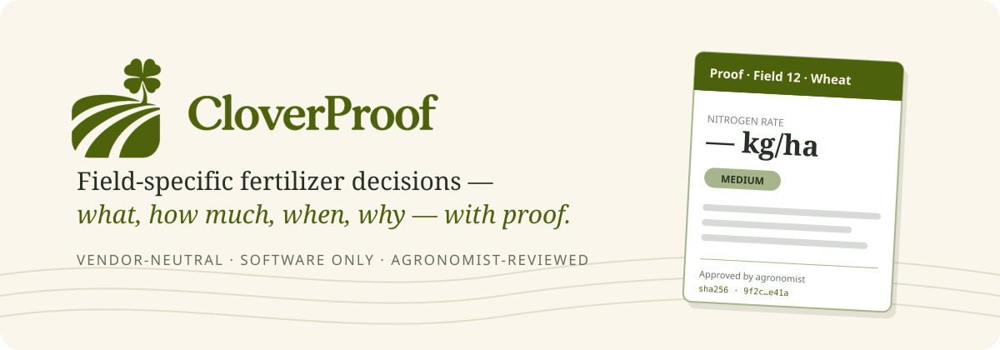
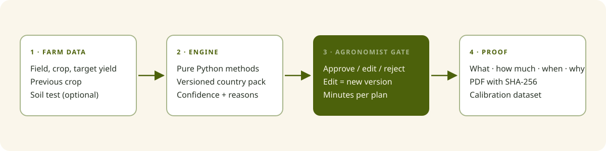
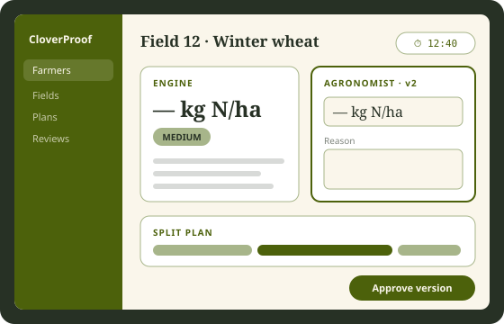
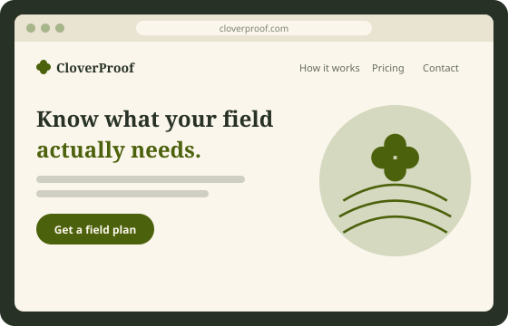
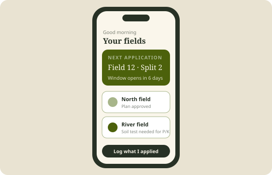
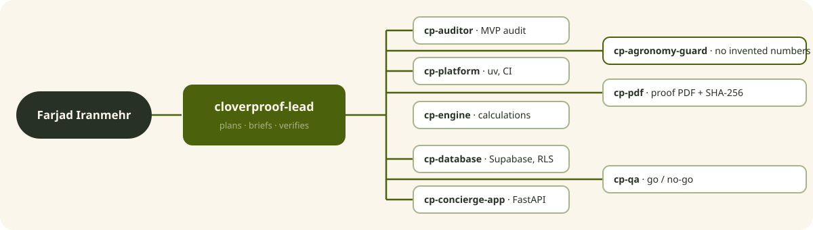

<p align="center">
  
</p>

<p align="center">
  
  
  
  
</p>

**CloverProof** (formerly Rootwise) turns farm data — a field plus a soil test, or no test at all — into a complete, field-specific fertilizer decision: **what, how much, when and why**, plus a proof PDF an agronomist has signed off. Vendor-neutral. Software only. One global core with versioned country packs.

## How it works

<p align="center"></p>

Every plan keeps both the **engine's output** and the **agronomist's final numbers with a reason**. That difference is our calibration dataset — it is never lost.

## Product surfaces

CloverProof has three surfaces. They ship in order; the internal web app comes first.

### 1 · Web application &nbsp;`now`



| | |
|---|---|
| **Who** | Our agronomist (concierge tool), later farmers and advisors |
| **Phase 0–3** | Internal tool in `app/` — FastAPI + Jinja2 + HTMX, Supabase auth |
| **Does** | Farmer/field list → plan form → engine suggestion with explanations and confidence → agronomist edits (new version + reason) → review gate → proof PDF |
| **Measures** | Agronomist minutes per plan, engine-vs-agronomist difference |
| **Phase 4** | Farmer-facing Next.js app on the same engine and database |

### 2 · Website &nbsp;`later`



| | |
|---|---|
| **Who** | Farmers, advisors, partners |
| **Purpose** | Explain the method, show a sample proof, collect field-plan requests |
| **Status** | Not started. Planned with the Phase 4 farmer app |
| **Rule** | No claim that any third party "accepts" or "approves" a CloverProof document |

### 3 · Mobile application &nbsp;`later`

<p align="center"></p>

| | |
|---|---|
| **Who** | Farmers in the field |
| **Purpose** | See the approved plan, get the next application window, log what was actually applied (planned vs actual) |
| **Status** | Out of scope for Phase 0–3. Native mobile is explicitly deferred |

> Mockups are concepts, not shipped screens. Numbers are shown as "—" on purpose: no agronomic value appears anywhere until our agronomist validates it.

## Principles

1. **Software only** — no hardware, no sensor code.
2. **Confidence on every number** — `high` / `medium` / `low`, rule-based.
3. **No soil test → nitrogen only** (max `medium`); for P/K we recommend a test.
4. **Immutable recommendations** — an edit is a new version with `parent_id` + reason.
5. **Full provenance** — input snapshot, engine version, country-pack version on every recommendation.
6. **Country packs, not forks** — versioned config + golden tests.
7. **Explicit units** — kg/ha and mg/kg; P vs P₂O₅ and K vs K₂O, extraction method, depth and date always stored.
8. **Review gate** — nothing reaches a farmer without agronomist approval.
9. **No invented agronomy** — missing constants are labelled `PLACEHOLDER` with a TODO for the agronomist.

## Stack

| Layer | Choice |
|---|---|
| Engine | Pure Python 3.12 package `engine/` — no I/O, fully unit-tested, golden tests |
| Database | Supabase — Postgres + PostGIS, Auth, Storage, RLS by organisation |
| Internal tool | FastAPI + Jinja2 + HTMX in `app/` |
| Proof PDF | HTML → WeasyPrint, SHA-256 stored per document |
| Tooling | uv, ruff, pytest, pre-commit, GitHub Actions |

```
engine/              pure calculation library + golden tests
packs/               versioned country packs (placeholder/v0.yaml is NOT real agronomy)
supabase/migrations/ schema + RLS
app/                 internal concierge tool + PDF templates
docs/                ADRs, sprints, audit, agent team
```

## Roadmap

| Sprint 1 · Nov 16–27, 2026 | Owner |
|---|---|
| 1. Audit the existing MVP → ADR 0001 | `cp-auditor` |
| 2. Scaffold the monorepo, CI green | `cp-platform` |
| 3. Engine v0 — wheat, nitrogen, mass balance, test-first | `cp-engine` + `cp-agronomy-guard` |
| 4. Database schema, RLS, ADR 0002 | `cp-database` |
| 5. Internal concierge tool | `cp-concierge-app` |
| 6. Proof PDF v0 | `cp-pdf` |

**Exit:** 5 real plans in the tool, engine-vs-agronomist difference saved for each, average minutes per plan measured. Field season with 5–10 farms: Feb–Apr 2027. Details in [`docs/sprints/sprint-1.md`](docs/sprints/sprint-1.md).

## Built with an agent team



This repo is developed with [Claude Code](https://claude.com/claude-code). One agent, **`cloverproof-lead`**, is the single point of contact; it plans, briefs the specialists in [`.claude/agents/`](.claude/agents), verifies their work and reports back. See [`docs/agents.md`](docs/agents.md).

```bash
# Claude desktop app: open a chat in this folder — it runs as cloverproof-lead.
# Terminal (optional):
claude --agent cloverproof-lead
```

## Getting started

Code lands in Sprint 1 Step 2. Until then:

```bash
cp .env.example .env   # fill locally, never commit
```

Read [`CLAUDE.md`](CLAUDE.md) before contributing — its hard rules are non-negotiable.

---

<sub>© 2026 CloverProof. All rights reserved.</sub>
