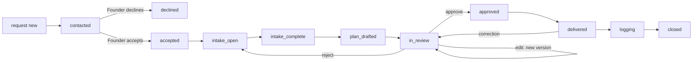

# SOP — Pilot farm lifecycle (Feb 1 – Apr 30, 2027)

- Purpose: run 5–10 pilot farms from request to close, with every plan feeding the calibration dataset.
- Trigger: a row appears in `pilot_request` (status `new`) from the website form (`website/db/migrations/0001_pilot_request.sql`).
- Owner: Operator (today Farjad Iranmehr). Review date: end of S6 (first sprint of the season), then every sprint retro.
- Tools: `pilot_request` table; concierge tool (`docs/plans/webapp-v1.md`; tables per `docs/adr/0002-data-model.md`, migrations 0003–0009); email (farmer channel); weekly ops note.
- All time targets are `PROPOSED — validate in S3 workload model`. Business days, Eastern time.

## Roles and RACI

Today one person (Farjad Iranmehr) holds all three roles. Roles are named so they can be split later.

| Role | Does |
|---|---|
| Operator | Intake, farmer contact, delivery, log collection, close, weekly cadence |
| Agronomist | Reviews and owns every number; approve / edit / reject; sole sender-of-approval |
| Founder | Accepts or declines pilot farms; handles escalations and deletion decisions |

R = does, A = accountable, C = consulted, I = informed.

| Step | Operator | Agronomist | Founder |
|---|---|---|---|
| 1 Triage request | R | C | A |
| 2 Intake | R/A | C | I |
| 3 Plan (engine run) | R/A | C | I |
| 4 Review | I | R/A | I |
| 5 Delivery | R/A | C (approval gate) | I |
| 6 Application log | R/A | C | I |
| 7 Feedback and close | R | C | A |
| Correction, deletion, escalation | R | R (numbers) | A |

## Status model

Two records, two status sets. `pilot_request.status` already exists (new, contacted, accepted, declined). `pilot_farm` status is an ops label; it needs a column or field in the concierge tool (open decision 1); until then keep it in the weekly ops sheet.

| Status | Set by | Meaning |
|---|---|---|
| new / contacted / accepted / declined | Operator (Founder decides accept/decline) | `pilot_request.status` |
| intake_open | Operator | Farm, field, crop plan being filled in |
| intake_complete | Operator | Entry criteria of step 3 met |
| plan_drafted | tool (engine run) | `recommendation` kind `engine` exists |
| in_review | tool | Awaiting `review` row |
| approved | tool (`review` decision approve) | Only state from which a proof PDF can be made |
| delivered | Operator | Email sent, date recorded |
| logging | Operator | Waiting for actual applications |
| closed | Founder | Feedback taken, data retained or deleted per rules below |

## Steps

| # | Step | Entry | Actions (tool) | Exit | Time target (PROPOSED) |
|---|---|---|---|---|---|
| 1 | Triage request | `pilot_request` status `new` | Read row; check country, crop, farm size against pilot scope (Founder); set `contacted`, send first reply by email; then `accepted` or `declined` with a reply either way | Status `accepted` or `declined`; consent_at/consent_text present | First reply ≤ 2 business days; decision ≤ 5 business days after reply |
| 2 | Intake | `accepted` | Create farm, field(s), season, crop plan in concierge tool; collect field size, crop, previous crop, target yield, soil test (see below). Send intake checklist (from `customer-onboarding-specialist`) | All required inputs present or explicitly marked missing; soil test attached or "none" recorded | Checklist sent ≤ 1 business day after accept; chase every 3 business days; stop after 3 chases, mark `paused` |
| 3 | Plan (engine run) | `intake_complete` | Run engine from the tool. Engine stores input snapshot, engine version, pack id/version/status/sha256, confidence | `recommendation` kind `engine` saved, immutable | Same day as intake_complete |
| 4 | Agronomist review | `plan_drafted` | Open case, review each number and explanation; decide approve / edit / reject; record reason and `minutes_spent` (timer in tool) | `review` row saved with decision and `minutes_spent`; edit creates a new `agronomist` recommendation (parent_id + reason) | Reviewed ≤ 3 business days after plan_drafted |
| 5 | Proof delivery | `approved` | Generate proof PDF from the approved version (`proof_document`, sha256 stored); check the PDF checklist; Operator emails PDF plus 5-line cover note | Email sent; delivery date and sha256 noted on the case | ≤ 1 business day after approval |
| 6 | Application log | `delivered` | Ask farmer for actual applications (product, nutrient amount, date, field); enter as `application_log` actual vs planned | Log complete for the season, or farmer marked non-responsive | First ask ≤ 7 days after delivery; reminder every 14 days; final entry by May 7 |
| 7 | Feedback and close | Log complete / season over | 15-minute call or 5-question email; record what the farmer did and why; Founder closes | Status `closed`; feedback saved | ≤ 14 days after log complete |

Rejection path (step 4): reject needs a reason, status returns to intake_open, Operator tells the farmer only what is needed (e.g. missing data). A rejected plan is never shown. Re-run in step 3 creates a new engine recommendation.

## Gates (non-negotiable)

| # | Gate | Where enforced | Check |
|---|---|---|---|
| G1 | No number reaches a farmer without agronomist approval | Step 5 entry | `review` decision approve exists for the exact recommendation id in the PDF; never forward engine output, screenshots or partial numbers by email, chat or call |
| G2 | No soil test: nitrogen only, confidence at most `medium`; P/K shown as "get a soil test" | Steps 2, 3, 4 | PDF contains no P or K rate when no soil test is attached |
| G3 | Recommendations never edited in place | Step 4 | Edit = new version with parent_id and reason; database enforces it (migrations 0006, 0007) |
| G4 | Every review records `minutes_spent` | Step 4 | Review row has it; weekly check lists reviews where it is 0 |
| G5 | Engine output and agronomist final and reason kept per plan | Steps 3, 4 | Diff view (migration 0009) shows both; never delete the engine row |
| G6 | Proof PDF never claims acceptance by any third party (lender, certifier, regulator) | Step 5 | Read the PDF text before sending; wording of any such claim is removed |
| G7 | Pilot constants are PLACEHOLDER; confidence shows low | Steps 4, 5 | See communication rule below |

### Placeholder constants and low confidence: how to say it

The Agronomist owns the numbers: the approved plan is the Agronomist's recommendation, not an engine output. The cover note (Operator drafts, Agronomist approves) states three things in plain language: (1) this is a pilot, the tool's calculation constants are still being validated; (2) every number was checked and approved by Farjad Iranmehr as agronomist; (3) the confidence label (low during the pilot) means treat the plan as a starting point and tell us the outcome. Do not hide or rename the confidence value. Wording to be reviewed by `legal-compliance-specialist` (open decision 3).

## Soil tests: missing, old, unclear

Do not invent validity windows or age limits. Farjad Iranmehr (Agronomist) sets them; until set, record and escalate.

| Case | Action | Plan result |
|---|---|---|
| No soil test | Record `none`; engine runs N only; PDF says "get a soil test" for P/K | N only, confidence at most `medium` |
| Test exists, date old | Record date; Agronomist decides at review whether to use it (acceptable age is an open decision, `docs/agronomist-todo.md`) | Used with reason, or treated as no test |
| Missing method, depth, date, or P/K form (P vs P2O5, K vs K2O) | Ask farmer or lab; do not guess | Cannot be entered until all four are known; else treated as no test |
| Method "other" | Enter as `other` with description (database requires it) | Agronomist decides at review |
| Lab report unreadable | Ask farmer for a photo/PDF again; OCR is out of scope | Wait, count against chase limit |

## After delivery

| Event | Action | Time target (PROPOSED) |
|---|---|---|
| Correction needed (error, new soil test, changed crop plan) | Agronomist creates a new version via step 4 (reason required); new PDF; Operator emails farmer saying which version supersedes which and what changed; old PDF is kept, never deleted | Notify ≤ 1 business day after approval of new version |
| Farmer asks "can I change a number" | Treated as correction request; only the Agronomist changes it, with reason | Reply ≤ 2 business days |
| Farmer disputes outcome or reports damage | Escalate (below) the same day; no admission or advice by Operator | Same business day |

## Data deletion request

Legal handling belongs to `legal-compliance-specialist`; this is the ops path only.

| Step | Owner | Action |
|---|---|---|
| 1 | Operator | Log date and requester; verify the request comes from the email on file; reply with receipt ≤ 2 business days (PROPOSED) |
| 2 | Operator | Set `pilot_request.deleted_at` (purge job is "later" per migration comment; until it exists, Operator purges manually) |
| 3 | Founder | Decide on farm/field/plan/recommendation data: delete, or anonymise if it is needed for the calibration dataset. Retention rule is an open decision; flag to legal. No deletion of immutable rows without Founder sign-off (CLAUDE.md: ask before deleting) |
| 4 | Operator | Confirm to the farmer in writing what was deleted and what, if anything, was kept and why |

## Escalation

| Trigger | To | Within (PROPOSED) |
|---|---|---|
| Result looks wrong, engine error, confidence rule broken | Founder, then `cp-agronomy-guard` via `coo` | Same day; pause deliveries |
| A number was sent without approval (G1 breach) | Founder, `coo`; notify farmer with corrected approved version | Same day |
| Farmer complaint, dispute, request for guarantees or lender/certifier claims | Founder; legal flag to `legal-compliance-specialist` | Same business day |
| Personal data incident | Founder, `ciso` | Same day |
| Request outside scope (hardware, other country pack, payments) | Operator declines in the reply; log it as demand | Step 1 |
| Review backlog > 3 plans or > 3 business days | Founder; Operator stops accepting new farms | Weekly cadence |

## Weekly ops cadence (proposed: Monday, 45 minutes, Operator runs)

| Item | Source | Output |
|---|---|---|
| Funnel: new, contacted, accepted, declined counts; oldest `new` row age | `pilot_request` | Rows past target listed with next action |
| Per-farm status table: farm, status, days in status, next action, owner | concierge tool | Stuck farms (over target) flagged |
| Review queue and `minutes_spent` per plan; rows with 0 | `review` | Input to S3 workload model; numbers via `data-analyst` through `coo` |
| Edit and reject rate, reasons | `review`, diff view | Feed calibration review (`data-scientist`, every sprint S6–S10) |
| Application-log completeness per delivered plan | `application_log` | Chase list |
| Open corrections, complaints, deletion requests | ops note | Escalations |
| Capacity: farms active vs 10 cap | status table | Accept or hold new farms |

Output: one dated ops note per week in `docs/operations/weekly/<yyyy-mm-dd>.md` (no farmer PII; use farm ids); a sprint summary goes to `coo`. Sprint retro per `docs/sprints/roadmap.md`.

## Checklist before every send (step 5)

- [ ] `review` approve row exists for this recommendation id
- [ ] No soil test: PDF shows N only and "get a soil test" for P/K
- [ ] Confidence label and placeholder notice visible
- [ ] No third-party acceptance claim (lender, certifier, regulator)
- [ ] sha256 of the PDF matches `proof_document`
- [ ] Sent to the email on file only; cover note approved

## Failure modes

| Failure | Response |
|---|---|
| Farmer silent in intake | 3 chases then `paused`; reopen on reply |
| Concierge tool down | Do not compute numbers by hand for farmers; hold deliveries, tell farmer the new date |
| Wrong PDF sent | Escalate as G1 breach if unapproved; else correction path |
| Agronomist unavailable | No deliveries; no delegate exists today (open decision 5) |

## Metric

Primary: agronomist `minutes_spent` per plan (target set in S3 workload model). Secondary: days request to delivered, % plans delivered within target, application-log completeness.

## Open decisions (Farjad Iranmehr)

1. Where `pilot_farm` status lives (new column vs ops sheet).
2. Acceptable soil-test age and any validity rules (`docs/agronomist-todo.md`).
3. Approve the placeholder/low-confidence cover-note wording and have legal review it.
4. Retention vs deletion of calibration data on a deletion request.
5. Backup person for review when the Agronomist is unavailable.
