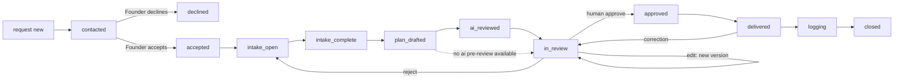

# SOP — Pilot farm lifecycle (Feb 1 – Apr 30, 2027)

- Purpose: run 5–10 pilot farms from request to close, with every plan feeding the calibration dataset.
- Trigger: a row appears in `pilot_request` (status `new`) from the website form (`website/db/migrations/0001_pilot_request.sql`).
- Owner: Operator (today Farjad Iranmehr, founder/operator; not the reviewing agronomist). Review date: end of S6 (first sprint of the season), then every sprint retro.
- Tools: `pilot_request` table; concierge tool (`docs/plans/webapp-v1.md`; tables per `docs/adr/0002-data-model.md`, migrations 0003–0009); email (farmer channel); weekly ops note.
- Launch scope: Canada, Ontario winter wheat; Prairie wheat is the backup. Plan timing (what, when, split) is set by the human agronomist per field; this SOP invents no dates or rates.
- Reviewer decision D4 (CPO, 2026-11-16, `docs/plans/backend-plan-reconciliation.md` on `origin/backend-traceability`): the AI specialist `cp-agronomist` pre-reviews; its sign-off is `ai_reviewed` and never counts as the review gate. Only a named human user with the `agronomist` role can set `agronomist_approved`.
- Approver decision (Farjad Iranmehr, 2026-11-16, CLAUDE.md rule 8 on `origin/cpo-decisions-sa-fe-residency`): a named **human** `superadmin` without the `agronomist` role may also approve; the review is labelled `superadmin_approved`. AI/service accounts never approve. Only `agronomist_approved` feeds the calibration dataset and the agreement gate. A `superadmin_approved` plan is never described as "reviewed/approved by an agronomist" or "agronomist review" (PDF Block B2). Liability flag: `docs/operations/legal/ontario-agronomist-credentials.md` §3.6.
- Residency decision (Farjad Iranmehr, 2026-11-16, OQ-06): real farmer data is stored in Canada. Until Canadian hosting (`[CANADIAN HOSTING PROVIDER, REGION]`, hosting ADR) is live, only synthetic or de-identified data in hosted environments (gate G9).
- PDF wording: `docs/operations/legal/proof-pdf-wording.md` (Block B for `agronomist_approved`, Block B2 for `superadmin_approved`; do not improvise wording).
- All time targets are `PROPOSED — validate in S3 workload model`. Business days, Eastern time.

## Roles and RACI

Today Farjad Iranmehr holds Operator and Founder. He is NOT the reviewing agronomist. If he holds `superadmin`, he may approve as **superadmin** (`superadmin_approved`), never as agronomist. The human agronomist is not named yet (target: before the S5 gate, Jan 29, 2027); written as `[HUMAN AGRONOMIST]` throughout. The superadmin approver is written `[SUPERADMIN]`.

| Role | Does |
|---|---|
| Operator | Intake, farmer contact, delivery, log collection, close, weekly cadence |
| AI reviewer (`cp-agronomist`) | Pre-review of each engine recommendation; writes findings and a suggested decision; sign-off = `ai_reviewed`. Not a human, not the gate. Never described as "reviewed by an agronomist" |
| Human agronomist (`[HUMAN AGRONOMIST]`) | Named user with the `agronomist` role. Reviews and owns every number; approve / edit / reject; the only source of `agronomist_approved`; sets soil-test validity rules and plan timing |
| Superadmin approver (`[SUPERADMIN]`) | Named human `superadmin` without the `agronomist` role. May approve / edit / reject when no agronomist reviews the plan; source of `superadmin_approved`. Not an agronomist; never described as one; owns the numbers they approve. Ontario farms only (never Prairie). Does not set soil-test validity rules |
| Founder | Accepts or declines pilot farms; names the human agronomist; handles escalations and deletion decisions |

R = does, A = accountable, C = consulted, I = informed.

| Step | Operator | AI reviewer | Human agronomist | Superadmin approver | Founder |
|---|---|---|---|---|---|
| 1 Triage request | R | - | C | - | A |
| 2 Intake | R/A | C (research questions) | C | - | I |
| 3 Plan (engine run) | R/A | I | C | I | I |
| 4a AI pre-review | I | R | I | I | I |
| 4b Human review (one approver per plan) | I | C | R/A (`agronomist_approved`) | R/A (`superadmin_approved`, only if the agronomist does not review) | I |
| 5 Delivery | R/A | - | C (approval gate) | C (approval gate) | I |
| 6 Application log | R/A | - | C | - | I |
| 7 Feedback and close | R | - | C | - | A |
| Correction, deletion, escalation | R | C | R (numbers) | R (numbers on plans they approved) | A |
| Name human agronomist + backup; name superadmin approver | I | - | - | - | R/A |

## Status model

Two records, two status sets. `pilot_request.status` already exists (new, contacted, accepted, declined). `pilot_farm` status is an ops label; it needs a column or field in the concierge tool (open decision 1); until then keep it in the weekly ops sheet.

| Status | Set by | Meaning |
|---|---|---|
| new / contacted / accepted / declined | Operator (Founder decides accept/decline) | `pilot_request.status` |
| intake_open | Operator | Farm, field, crop plan being filled in |
| intake_complete | Operator | Entry criteria of step 3 met |
| plan_drafted | tool (engine run) | `recommendation` kind `engine` exists |
| ai_reviewed | `cp-agronomist` via tool | AI pre-review recorded. Does NOT unlock delivery. Label it "AI pre-review" everywhere |
| in_review | tool | Awaiting a human `review` row. If no human agronomist is named, real-farm plans stay here (gate G0) |
| approved | tool (`review` decision approve by a human `agronomist` = `agronomist_approved`, or by a human `superadmin` without the agronomist role = `superadmin_approved`; the kind is stored on the review) | Only state from which a farmer-facing proof PDF can be made |
| delivered | Operator | Email sent, date recorded |
| logging | Operator | Waiting for actual applications |
| closed | Founder | Feedback taken, data retained or deleted per rules below |

## Steps

| # | Step | Entry | Actions (tool) | Exit | Time target (PROPOSED) |
|---|---|---|---|---|---|
| 1 | Triage request | `pilot_request` status `new` | Read row; check country, crop, farm size against pilot scope (Founder); set `contacted`, send first reply by email; then `accepted` or `declined` with a reply either way | Status `accepted` or `declined`; consent_at/consent_text present | First reply ≤ 2 business days; decision ≤ 5 business days after reply |
| 2 | Intake | `accepted` | Create farm, field(s), season, crop plan in concierge tool; collect field size, crop, previous crop, target yield, soil test (see below). Send intake checklist (from `customer-onboarding-specialist`) | All required inputs present or explicitly marked missing; soil test attached or "none" recorded | Checklist sent ≤ 1 business day after accept; chase every 3 business days; stop after 3 chases, mark `paused` |
| 3 | Plan (engine run) | `intake_complete` | Run engine from the tool. Engine stores input snapshot, engine version, pack id/version/status/sha256, confidence | `recommendation` kind `engine` saved, immutable | Same day as intake_complete |
| 4a | AI pre-review | `plan_drafted` AND gate G8 passed | `cp-agronomist` reads the de-identified case only (engine output, de-identified input snapshot and pack version — G8); lists doubts, missing inputs, units/form errors and a suggested approve / edit / reject with reasons; sign-off recorded as `ai_reviewed`. Machine time, not counted in `minutes_spent` | Pre-review note attached to the recommendation; status `ai_reviewed`. Never shown to a farmer | Same day as plan_drafted (PROPOSED) |
| 4b | Human review (agronomist, or superadmin) | `ai_reviewed` (or `plan_drafted` if AI pre-review is unavailable) AND a named human approver exists (G0) | Open case, read the AI note as input only, review each number and explanation yourself; decide approve / edit / reject; record reason and `minutes_spent` (timer in tool). Farm opted out of superadmin approval (pilot-terms §3.1): agronomist only | `review` row by the human with decision, approval kind and `minutes_spent`; edit creates a new recommendation (parent_id + reason) | Reviewed ≤ 3 business days after ai_reviewed |
| 5 | Proof delivery | `approved` | Generate proof PDF from the approved version (`proof_document`, sha256 stored; Block B or B2 by approval kind); check the PDF checklist; Operator emails PDF plus cover note for that approval kind (onboarding message 8A or 8B) | Email sent; delivery date and sha256 noted on the case | ≤ 1 business day after approval |
| 6 | Application log | `delivered` | Ask farmer for actual applications (product, nutrient amount, date, field); enter as `application_log` actual vs planned | Log complete for the season, or farmer marked non-responsive | First ask ≤ 7 days after delivery; reminder every 14 days; final entry by May 7 |
| 7 | Feedback and close | Log complete / season over | 15-minute call or 5-question email; record what the farmer did and why; Founder closes | Status `closed`; feedback saved | ≤ 14 days after log complete |

Rejection path (step 4b): reject needs a reason, status returns to intake_open, Operator tells the farmer only what is needed (e.g. missing data). A rejected plan is never shown. Re-run in step 3 creates a new engine recommendation.

## Gates (non-negotiable)

| # | Gate | Where enforced | Check |
|---|---|---|---|
| G0 | No named human approver: no delivery. A named human approver is required — `[HUMAN AGRONOMIST]` (role `agronomist`) or `[SUPERADMIN]` (human `superadmin`). Without one, real-farm plans stay `in_review`; no PDF, no number, no "preview" to the farmer | Steps 4b, 5 | At least one named human approver exists and is flagged human; else hold and tell Founder in the weekly note. Test/demo farms are labelled as such and never real farms |
| G1 | No number reaches a farmer without approval by a named human: `agronomist_approved` (human `agronomist`) or `superadmin_approved` (human `superadmin` without the agronomist role). `ai_reviewed` never satisfies G1; AI/service accounts never approve. Storage + AI-cannot-approve test: REC-D4 (`cp-database`) | Step 5 entry | `review` approve row by a human approver exists for the exact recommendation id in the PDF; the PDF block (B vs B2) and cover note (8A vs 8B) match the stored approval kind; `superadmin_approved` only for Ontario farms that have not opted out; never forward engine output, screenshots or partial numbers by email, chat or call |
| G2 | No soil test: nitrogen only, confidence at most `medium`; P/K shown as "get a soil test" | Steps 2, 3, 4b | PDF contains no P or K rate when no soil test is attached |
| G3 | Recommendations never edited in place | Step 4b | Edit = new version with parent_id and reason; database enforces it (migrations 0006, 0007) |
| G4 | Every human review records `minutes_spent` (AI pre-review time is not recorded there) | Step 4b | Review row has it; weekly check lists reviews where it is 0 |
| G5 | Engine output and human approver's final and reason kept per plan (AI note kept too). Only `agronomist_approved` rows enter the calibration dataset and the agreement gate | Steps 3, 4a, 4b | Diff view (migration 0009) shows both; never delete the engine row; calibration exports filter on approval kind |
| G6 | Proof PDF never claims acceptance by any third party (lender, certifier, regulator) | Step 5 | Read the PDF text before sending; wording of any such claim is removed |
| G7 | Pilot constants are PLACEHOLDER until a human agronomist validates them; confidence shows low | Steps 4b, 5 | See communication rule below |
| G8 | AI reviewer gets de-identified data only (D-7, CPO 2026-11-16). `cp-agronomist` never receives real pilot farmers' personal data or identifiable farm data; it works only on published sources, synthetic cases and de-identified case data. Changing this needs a DPA with the AI provider AND a privacy-notice update, decided by Farjad Iranmehr | Step 4a entry. Operator checks before every AI pre-review | Strip: name, email, phone, other contacts, postal address, farm and field names, free-text notes that name people or places, exact field geometry (boundaries, coordinates, lot/concession). Keep: county-level region, crop, soil-test values (with method, depth, units, form), previous crop, target yield, plan date. Operator ticks the checklist on the case; if any identifier remains, do not run 4a — go to 4b without AI pre-review |
| G9 | Residency (OQ-06, Farjad Iranmehr 2026-11-16): real farmer data is stored in Canada. Until Canadian hosting (`[CANADIAN HOSTING PROVIDER, REGION]`) is live, no real farm, field, soil test or farmer contact is entered in any hosted environment — synthetic or de-identified data only | Step 2 entry | Hosting ADR accepted and Canadian environment live; else do not start intake for real farms. Website pilot-request rows: location per `[WEBSITE FORM DATA LOCATION — confirm in hosting ADR]` |

### Placeholder constants and low confidence: how to say it

The human approver owns the numbers: the approved plan is that person's recommendation, not an engine output and not the AI's. The cover note (Operator drafts, the approver approves) states three things in plain language: (1) this is a pilot, the tool's calculation constants are still being validated; (2) by approval kind — `agronomist_approved`: every number was checked and approved by `[HUMAN AGRONOMIST]`, a named agronomist; `superadmin_approved`: every number was approved by `[SUPERADMIN]` (name, company role), who is not an agronomist, and the plan **was not reviewed by an agronomist** (message 8B); (3) the confidence label (low during the pilot) means treat the plan as a starting point and tell us the outcome. Never write "reviewed by an agronomist" for `ai_reviewed` or `superadmin_approved`; an AI pre-review may be mentioned only as "AI-assisted pre-check" if `docs/operations/legal/proof-pdf-wording.md` allows it. Do not hide or rename the confidence value. Wording to be reviewed by `legal-compliance-specialist` (open decision 3).

## Soil tests: missing, old, unclear

Do not invent validity windows or age limits. `[HUMAN AGRONOMIST]` sets them (`cp-agronomist` may research options, it does not decide); until set, record and escalate.

| Case | Action | Plan result |
|---|---|---|
| No soil test | Record `none`; engine runs N only; PDF says "get a soil test" for P/K | N only, confidence at most `medium` |
| Test exists, date old | Record date; human agronomist decides at review whether to use it (acceptable age is an open decision, `docs/agronomist-todo.md`) | Used with reason, or treated as no test |
| Missing method, depth, date, or P/K form (P vs P2O5, K vs K2O) | Ask farmer or lab; do not guess | Cannot be entered until all four are known; else treated as no test |
| Method "other" | Enter as `other` with description (database requires it) | Human agronomist decides at review |
| Lab report unreadable | Ask farmer for a photo/PDF again; OCR is out of scope | Wait, count against chase limit |

## After delivery

| Event | Action | Time target (PROPOSED) |
|---|---|---|
| Correction needed (error, new soil test, changed crop plan) | A human approver (agronomist, or superadmin per G1) creates a new version via step 4b (reason required; `cp-agronomist` pre-review again); new PDF; Operator emails farmer saying which version supersedes which and what changed; old PDF is kept, never deleted | Notify ≤ 1 business day after approval of new version |
| Farmer asks "can I change a number" | Treated as correction request; only a human approver (agronomist, or superadmin per G1) changes it, with reason | Reply ≤ 2 business days |
| Farmer disputes outcome or reports damage | Escalate (below) the same day; no admission or advice by Operator | Same business day |

## Data deletion request

Legal handling belongs to `legal-compliance-specialist`; this is the ops path only.

| Step | Owner | Action |
|---|---|---|
| 1 | Operator | Log date and requester; verify the request comes from the email on file; reply with receipt ≤ 2 business days (PROPOSED) |
| 2 | Operator | Set `pilot_request.deleted_at` (purge job is "later" per migration comment; until it exists, Operator purges manually) |
| 3 | Founder | Decide on farm/field/plan/recommendation data: delete, or anonymise if it is needed for the calibration dataset. Retention rule is an open decision; flag to legal. No deletion of immutable rows without Founder sign-off (CLAUDE.md: ask before deleting) |
| 4 | Operator | Confirm to the farmer in writing what was deleted and what, if anything, was kept and why |

## Escalation

| Trigger | To | Within (PROPOSED) |
|---|---|---|
| `cp-agronomist` flags a result as wrong, or engine error, confidence rule broken | Founder, then `cp-agronomy-guard` via `coo` | Same day; pause deliveries |
| A number was sent without approval (G1 breach) | Founder, `coo`; notify farmer with corrected approved version | Same day |
| Farmer complaint, dispute, request for guarantees or lender/certifier claims | Founder; legal flag to `legal-compliance-specialist` | Same business day |
| Personal data incident | Founder, `ciso` | Same day |
| Request outside scope (hardware, other country pack, payments) | Operator declines in the reply; log it as demand | Step 1 |
| Review backlog > 3 plans or > 3 business days, or no named human approver | Founder; Operator stops accepting new farms | Weekly cadence |

## Weekly ops cadence (proposed: Monday, 45 minutes, Operator runs)

| Item | Source | Output |
|---|---|---|
| Funnel: new, contacted, accepted, declined counts; oldest `new` row age | `pilot_request` | Rows past target listed with next action |
| Per-farm status table: farm, status, days in status, next action, owner | concierge tool | Stuck farms (over target) flagged |
| Review queue (split: awaiting AI pre-review, awaiting human) and human `minutes_spent` per plan; rows with 0; human agronomist named y/n | `review` | Input to S3 workload model; numbers via `data-analyst` through `coo` |
| Edit and reject rate, reasons | `review`, diff view | Feed calibration review (`data-scientist`, every sprint S6–S10) |
| Application-log completeness per delivered plan | `application_log` | Chase list |
| Open corrections, complaints, deletion requests | ops note | Escalations |
| Capacity: farms active vs 10 cap | status table | Accept or hold new farms |

Output: one dated ops note per week in `docs/operations/weekly/<yyyy-mm-dd>.md` (no farmer PII; use farm ids); a sprint summary goes to `coo`. Sprint retro per `docs/sprints/roadmap.md`.

## Checklist before every send (step 5)

- [ ] `review` approve row by a human approver exists for this recommendation id (`agronomist_approved` or `superadmin_approved`; not `ai_reviewed`)
- [ ] PDF text follows `docs/operations/legal/proof-pdf-wording.md`: Block B for `agronomist_approved`, Block B2 for `superadmin_approved`; no "reviewed by an agronomist" tied to an AI or superadmin sign-off
- [ ] Cover note matches the approval kind (message 8A or 8B); `superadmin_approved` only for an Ontario farm that has not opted out
- [ ] No soil test: PDF shows N only and "get a soil test" for P/K
- [ ] Confidence label and placeholder notice visible
- [ ] No third-party acceptance claim (lender, certifier, regulator)
- [ ] sha256 of the PDF matches `proof_document`
- [ ] Sent to the email on file only; cover note approved

## Failure modes

| Failure | Response |
|---|---|
| Farmer silent in intake | 3 chases then `paused`; reopen on reply |
| Concierge tool down | Do not compute numbers by hand for farmers; hold deliveries, tell farmer the new date |
| Wrong PDF sent | Escalate as G1 breach if unapproved; else correction path |
| Human agronomist not named, or unavailable | Superadmin may approve (`superadmin_approved`, Ontario farms that have not opted out); if no named human approver at all, no deliveries, plans stay `in_review`; AI pre-review may continue (open decision 5) |

## Metric

Primary: human agronomist `minutes_spent` per plan (target set in S3 workload model); report `superadmin_approved` plans separately and exclude them from the agreement gate. Secondary: days request to delivered, % plans delivered within target, application-log completeness.

## Open decisions (Farjad Iranmehr)

1. Where `pilot_farm` status lives (new column vs ops sheet).
2. Acceptable soil-test age and any validity rules: for `[HUMAN AGRONOMIST]` once named (`docs/agronomist-todo.md`).
3. Approve the placeholder/low-confidence cover-note wording and have legal review it (with `docs/operations/legal/proof-pdf-wording.md`).
4. Retention vs deletion of calibration data on a deletion request.
5. Name the human agronomist and a backup reviewer, both with the `agronomist` role (target: before the S5 gate, Jan 29, 2027), and name the superadmin approver. Until a named human approver exists, G0 applies: no real-farm delivery. Before the first `superadmin_approved` plan reaches a farm: E&O answer and copy audit (`ontario-agronomist-credentials.md` §3.6). Hiring and contract terms are outside this SOP.
