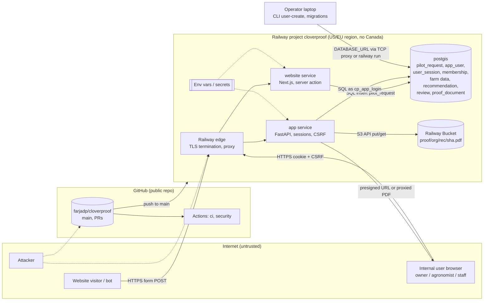

# Threat model — CloverProof internal web app (Phase 0–3)

- Author: `security-engineer` for `ciso`, 2026-11-16. Status: draft for S2.
- Scope: FastAPI + Jinja2 + HTMX internal tool (`app/`), Postgres + PostGIS on Railway, Railway Bucket for proof PDFs, the public website pilot form (`website/`), the public GitHub repo `farjadp/cloverproof` and its CI.
- Sizing: ≤ 4 internal users (owner / agronomist / staff), 5–10 pilot farms, release Feb 1 2027. Controls are chosen for that size: no WAF, no SIEM, no paid service.
- Sources: ADR 0002, 0004, 0005; `docs/runbook-db-switch.md`; branch `webapp-step5-app` @ c720eec; `gh api` reads of repo settings on 2026-11-16; review `docs/security/S2-auth-review-step5.md` (findings S1–S8, N1–N10 referenced below).
- Sprint dates are an estimate from Sprint 1 (Nov 16–27, two-week cadence): S2 Nov 30–Dec 11, S3 Dec 14–24, S4 Jan 4–15, S5 Jan 18–29 2027.

## 1. Data flow

### Trust boundaries
| ID | Boundary | Crosses |
|---|---|---|
| TB1 | Internet → Railway edge → app | login, every HTMX/form request |
| TB2 | Internet → Railway edge → website | pilot form (anonymous) |
| TB3 | App / website → Postgres | SQL; role decides what each service can do |
| TB4 | App → Bucket; Bucket → user (presigned URL) | proof PDFs |
| TB5 | GitHub → Railway (auto-deploy from `main`) and GitHub → Actions | code and supply chain |
| TB6 | Operator laptop → Postgres / Railway dashboard | admin CLI, migrations, env vars |
| TB7 | Railway (US/EU region) ↔ Canadian data subjects | data residency |

## 2. Assets
| ID | Asset | Why it matters |
|---|---|---|
| A1 | Approved recommendations + reviews (incl. engine vs final diff) | The product and the calibration dataset; hard rules 4, 5, 8 |
| A2 | Proof PDFs + SHA-256 | Evidence given to farmers; integrity is the selling point |
| A3 | Credentials and sessions (`app_user`, `user_session`, `SESSION_SECRET`) | Identity of the approver |
| A4 | Farm and farmer data (names, fields, soil tests, geometry) | Client confidential data, PII |
| A5 | Pilot requests (name, email, country, notes) | PII from the public, consent records |
| A6 | Secrets: DB passwords, bucket keys, Railway/GitHub accounts | Root of everything above |
| A7 | Availability during Feb–Apr 2027 | 5–10 farms must be planned in one season |

## 3. Actors
Anonymous internet user / bot; credential-stuffing attacker; malicious or careless staff member (has `staff` but not `agronomist`); compromised dependency or GitHub Action; someone with Railway or GitHub account access; a farmer (no login until Phase 4).

## 4. Threats (STRIDE)

Likelihood (L) and impact (I): H / M / L, estimated for this size and exposure. Status: **Gap** = not mitigated yet.

### 4.1 Auth, sessions, CSRF, rate limit (TB1, A3, A7)
| ID | STRIDE | Threat | L | I | Existing controls | Gap → mitigation | Owner | Sprint |
|---|---|---|---|---|---|---|---|---|
| T-A1 | S | Online password guessing / stuffing against the 4 accounts | M | H | argon2id, min 12 chars, generic errors, 5/15 min per (email, IP) | Limiter key wrong behind proxy, spoofable with `*`, no per-account ceiling (S1). Fix limiter + deliberate proxy trust | `cp-concierge-app` | S2 |
| T-A2 | D | Lock out the agronomist by failing logins with his email | M | M | — | Same as S1: per-IP block, per-account soft limit, CLI unlock | `cp-concierge-app` | S2 |
| T-A3 | D | Login flood exhausts CPU/RAM via argon2 (64 MiB each) | M | M | rate limit per key | Hashing semaphore + global failure budget (S2) | `cp-concierge-app` | S2 |
| T-A4 | S | Stolen session survives password reset | L | H | idle 2 h, absolute 12 h, disable kills sessions | Revoke all sessions on reset; revoke CLI (S3) | `cp-concierge-app` | S2 |
| T-A5 | S | No second factor; one phished password = approver identity | M | H | `totp_secret` column exists, unused | TOTP for `owner` and `agronomist` (ADR 0005 allows it); encryption key from env | `cp-concierge-app` | S4 |
| T-A6 | T | CSRF / login CSRF | L | M | per-session HMAC token on all non-GET, login token, SameSite=Lax | `__Host-` cookies + signed login token on custom domain (N1); `Sec-Fetch-Site` check (N2) | `cp-concierge-app` | S3 |
| T-A7 | I | Session cookie sent over HTTP / downgrade | L | H | Secure flag enforced in staging/prod | HSTS (S8); custom domain on HTTPS only | `cp-platform` | S3 |
| T-A8 | E | Account creation outside the CLI | L | H | no sign-up route | Keep; review any new route that writes `app_user`/`membership` | `security-engineer` | each PR |

### 4.2 Org scoping without RLS (TB3, A1, A4)
| ID | STRIDE | Threat | L | I | Existing controls | Gap → mitigation | Owner | Sprint |
|---|---|---|---|---|---|---|---|---|
| T-O1 | I | IDOR: a route loads a farmer/field/recommendation by id without `org_id` | M | H | rule "every repo function takes `org_id`"; composite FKs; org tests | Rule is convention only. Add a test that greps `app/cloverproof_app/repo/*.py` for queries on org-owned tables lacking `organisation_id = %s`; two-org tests per new route | `cp-concierge-app` + `cp-qa` | S3 |
| T-O2 | E | App (bug, injection) grants itself `agronomist` then approves | L | H | review trigger checks membership | `cp_app` can write `membership`/`app_user`; revoke, column grant for `password_hash`, separate CLI admin role (S5) | `cp-database` | S2 |
| T-O3 | E/T | App runs as superuser: grants void, triggers can be disabled | M | H | runbook says use `cp_app_login` | Startup check refuses superuser / non-`cp_app` in staging/prod (S4) | `cp-concierge-app` | S2 |
| T-O4 | I | Org switch by forged cookie | L | M | HMAC cookie bound to session, membership re-checked | none | — | — |

### 4.3 Immutable recommendations and review gate (A1)
| ID | STRIDE | Threat | L | I | Existing controls | Gap → mitigation | Owner | Sprint |
|---|---|---|---|---|---|---|---|---|
| T-R-1 | T | Edit an approved recommendation in place | L | H | `forbid_change` triggers for every role, no UPDATE/DELETE grant for `cp_app` | Holds only if the app is not superuser (T-O3) and the website is not superuser (T-W3) | `cp-database` | S2 |
| T-R-2 | R | Staff approves, or reviewer forged from form | L | H | DB trigger requires `agronomist`; ADR: `reviewer_id` from session | Review route not written yet (Step 5B): re-review it; test that a posted `reviewer_id` is ignored | `security-engineer` | S3 |
| T-R-3 | T | Superuser (operator or stolen creds) disables triggers and rewrites history | L | H | none beyond access control | Weekly logical dump to a second location + hash chain or periodic export of `sha256(result)` per approved row to the bucket, so tampering is detectable | `cp-database` | S4 |
| T-R-4 | R | Agronomist denies an approval | L | M | reviewer, timestamp, minutes stored, insert-only | Optional: log session id on review row | `cp-database` | S5 |

### 4.4 Proof PDF integrity (TB4, A2)
| ID | STRIDE | Threat | L | I | Existing controls | Gap → mitigation | Owner | Sprint |
|---|---|---|---|---|---|---|---|---|
| T-P1 | T | PDF replaced in the bucket | L | H | key contains sha256; app re-hashes on download (ADR 0005) | Enforce in code: refuse to serve on mismatch, alert; never `put` an existing key (`If-None-Match: *` or head-then-put). Test both | `cp-pdf` | S3 |
| T-P2 | I | Presigned URL leaked (email forward, logs, referrer) | M | M | — | Prefer streaming through the app (auth-checked, `Cache-Control: no-store`). If presigned: ≤ 5 min, GET only, never logged, `Content-Disposition: attachment` | `cp-pdf` | S3 |
| T-P3 | I | Bucket keys leaked; bucket made public | L | H | private by default | Keys only in Railway vars; app key scoped to the one bucket; check bucket stays private in release checklist | `cp-platform` | S4 |
| T-P4 | S | Farmer receives a forged PDF claiming to be ours | L | M | SHA-256 stored | Print the SHA-256 and a verify URL/route on the PDF (Phase 4 portal) | `cp-pdf` | S5 |
| T-P5 | E | HTML→PDF (WeasyPrint) fetches external URLs or local files from user text | M | M | — | Custom `url_fetcher` that allows only packaged assets; autoescape templates; no user-supplied URLs | `cp-pdf` | S3 |

### 4.5 Public GitHub repo, CI, supply chain (TB5, A6)
| ID | STRIDE | Threat | L | I | Existing controls | Gap → mitigation | Owner | Sprint |
|---|---|---|---|---|---|---|---|---|
| T-R1 | I | Secret committed to the public repo | M | H | `.gitignore` covers `.env*`; `detect-private-key` hook; gitleaks workflow being added (untracked `security.yml` in this worktree, another session) | Secret scanning **and push protection are disabled** (gh api 2026-11-16): enable both (free on public repos); land the gitleaks job | Farjad (GitHub settings) + `cp-platform` | S2 |
| T-R2 | T | Unreviewed push to `main` auto-deploys to Railway | M | H | 1 collaborator; workflow token read-only | `main` is **not protected** and no rulesets exist: add a ruleset (PR required, CI + security checks required, no force push, no deletion) | Farjad (GitHub settings) | S2 |
| T-R3 | T | Compromised Action (tag moved) | L | H | `ci.yml` uses `@v7` tags (`ci.yml:23,25`); new `security.yml` pins SHAs | Pin `ci.yml` actions to SHAs; set "require SHA pinning" / allow-list actions (currently `allowed_actions: all`) | `cp-platform` | S2 |
| T-R4 | T | Malicious/typosquat dependency or vulnerable version | M | M | `uv.lock` frozen, `package-lock.json`; Dependabot + pip-audit + npm audit being added | Land `dependabot.yml` + `security.yml`; enable Dependabot security updates (disabled now) | `cp-platform` | S2 |
| T-R5 | I | Auth tests never run in CI | H | M | tests exist | DB test job with PostGIS service (S7) | `cp-qa` | S2 |
| T-R6 | I | Public code reveals internals (routes, schema) | H | L | accepted: security does not rely on secrecy | none | — | — |

### 4.6 Railway hosting (TB3, TB6, TB7, A6, A7)
| ID | STRIDE | Threat | L | I | Existing controls | Gap → mitigation | Owner | Sprint |
|---|---|---|---|---|---|---|---|---|
| T-H1 | E | Railway account takeover = everything (vars, DB, deploys) | L | H | — | 2FA on Railway and GitHub accounts (verify), no extra project members, recovery codes offline | Farjad | S2 |
| T-H2 | I | Postgres reachable from internet via TCP proxy | M | H | runbook: no public proxy except one-off | Release checklist item: TCP proxy off; operator uses `railway run`/temporary proxy then removes it; rotate superuser password after any proxy session | `cp-platform` | S3 |
| T-H3 | D | Data loss (volume, bad migration) | L | H | runbook: enable volume backups | Verify backups enabled + one restore drill on staging before Feb 1; `pg_dump` before each migration | `cp-database` | S4 |
| T-H4 | I | Data residency: farm data and PII in US/EU region | H | M | ADR 0004 acknowledges | Decision for Farjad: document region, tell pilot farmers in the privacy notice/consent (PIPEDA allows cross-border with notice); revisit for Phase 4 | Farjad + `ciso` | S3 |
| T-H5 | I | Env vars visible to anyone with project access; logs contain PII | M | M | logs avoid email/IP for logins | Separate staging project/env; review log lines for PII each step; no `console.error(error)` with row values (T-W4) | `cp-platform` | S3 |
| T-H6 | T | Website and app share one DB with one superuser credential | H | H | — | See T-W3 | `cp-database` | S2 |

### 4.7 Website pilot form (TB2, A5)
Evidence: `website/src/app/[lang]/actions.ts` (server action), `db/migrations/0001_pilot_request.sql`.

| ID | STRIDE | Threat | L | I | Existing controls | Gap → mitigation | Owner | Sprint |
|---|---|---|---|---|---|---|---|---|
| T-W1 | D | Spam / bot floods the table | H | L | honeypot field, length limits, DB CHECKs | Per-IP rate limit in the action (in-memory is fine for one instance) and a daily row cap alert; add a free challenge (Cloudflare Turnstile) only if spam appears | `cp-website` | S3 |
| T-W2 | T | SQL injection | L | H | parameterised `$1…$8` query, server-only module | none | — | — |
| T-W3 | E | Website compromise (Next.js CVE, dependency) gives DB superuser → reads `app_user`, sessions, farm data; disables triggers; rewrites approvals | M | H | — | `docs/runbook-db-switch.md:24` sets the website `DATABASE_URL` to the PostGIS superuser. Before the switch: `create role cp_website_login login ...` with `usage` on schema and `insert` on `pilot_request` only (no select). **Do not run step 4 of the runbook until this exists** | `cp-database` + `cp-website` | S2 |
| T-W4 | I | PII in logs: `console.error("requestPilot failed", error)` — pg errors on CHECK violations include the failing row (name, email) in `detail` | M | M | — | Log `error.code` and constraint name only | `cp-website` | S3 |
| T-W5 | I | Stored XSS when staff later view pilot requests in an admin UI | M | M | no viewer yet | Viewer must autoescape; treat `notes` as text only | `cp-concierge-app` | when built |
| T-W6 | R | Consent dispute | L | M | `consent_at`, exact `consent_text` stored | none | — | — |
| T-W7 | I | Missing security headers on the website | M | L | — | CSP, HSTS, nosniff, frame-ancestors in `next.config.ts` headers | `cp-website` | S4 |
| T-W8 | I | Retention: PII kept forever | M | M | `deleted_at` column | Retention rule (e.g. delete declined after 12 months) + the purge job | `ciso` + `cp-database` | S5 |

## 5. Top risks (ranked)
1. **T-W3 / T-H6** — public website with the DB superuser credential (as written in the runbook) → full read of users/farm data and silent rewrite of approved recommendations. Least-privilege website role before the switch.
2. **T-O3 + T-O2** — app as superuser or `cp_app` able to edit `membership`: the database half of the review gate and immutability collapses to app correctness. Startup role check + revoke membership writes.
3. **T-R2 + T-R1** — unprotected `main` that auto-deploys, on a public repo with secret scanning and push protection off. Ruleset + enable scanning (15 minutes of settings, free).
4. **T-A1 / T-A2 / T-A3** — login limiter mis-keyed behind Railway and argon2 flood: lockout or unlimited guessing on the one approver account; then TOTP (T-A5) for the approver.
5. **T-P1 / T-P2** — proof PDF integrity and exposure: write-once keys, re-hash on serve, stream through the app instead of long-lived presigned URLs.

## 6. Residual risk accepted for Phase 0–3 (for `ciso` sign-off)
- Data stored outside Canada (T-H4), with notice to pilot farmers.
- In-memory rate limiter on one instance (restart clears counts).
- No MFA until S4 (T-A5).
- No independent tamper evidence for a superuser-level attacker until S4 (T-R-3).
- Public source code (T-R6).
